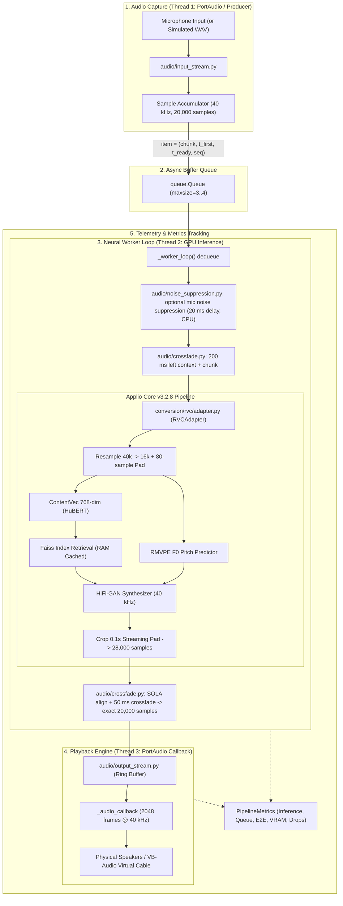

# System Architecture

## Overview

RealTimeVoiceChanger is structured around clean separation of concerns, decoupling audio capture/playback, pipeline orchestration, parameter tuning, and voice conversion inference engines.

## Module Responsibilities

### 1. `src/voice_changer/audio/`

Manages physical and virtual audio hardware communication and end-to-end streaming orchestration:

- **`devices.py`**: Enumerates and queries audio host APIs (WASAPI, MME, DirectSound) for inputs (microphones) and outputs (speakers, virtual cables).
- **`input_stream.py`**: Non-blocking microphone input capture using `sounddevice.InputStream` with low-latency block sizing (2048 frames).
- **`output_stream.py`**: Thread-safe ring buffer playback via `sounddevice.OutputStream` with prebuffering (`prebuffer_seconds = 0.15s`), underrun classification (startup silence vs steady-state glitch vs shutdown drain), and overflow protection.
- **`pipeline.py`**: Implements `RealTimeVoiceChangerPipeline` and `PipelineMetrics`. Coordinates multi-threaded producer accumulation, async bounded queue dispatch, GPU worker conversion, and latency tracking.
  - Lifecycle: `start()` drains chunks left from a previous session and rolls back (closes the output stream, joins the worker) if a later step fails; `stop()` reports a worker still inside inference (`worker_stuck`) and `start()` refuses until it finishes.
  - Overload: when `max_queue_size` chunks wait, the oldest is dropped and counted (`total_chunks_dropped`). Inference errors are counted with the last message and a consecutive-error count. Output-buffer overflows and PortAudio status flags are counted. Real-time callbacks only update counters (no logging).
  - `update_config()` swaps the config reference atomically (applies from the next chunk); `health()` reports streams that stopped by themselves and a dead worker.
  - Input/output streams can be injected (`input_stream=`, `output_stream=`), used by tests and simulations.
- **`crossfade.py`** (chunk seams): `ChunkStitcher`. Each chunk is converted by an independent model call, so
  end-to-end joining leaves a waveform jump and level step at every 500 ms seam (measured 13–23× the normal
  sample-to-sample change on all three profiles, `output/live_audio_diag_2026-10-21/`), heard as choppy audio.
  The worker therefore gives each call 200 ms of previous input as context, holds back the last 60 ms of each
  output, aligns the next output to it (SOLA lag search, 0–10 ms) and crossfades 50 ms (sin²). Every chunk
  still emits exactly 20,000 samples; the cost is ~55 ms extra delay and ~+17 % inference time. Dropped or
  failed chunks reset the stitcher (`stitch_resets`). `context/crossfade/sola_search = 0` restores plain joining.
- **`noise_suppression.py`** (optional, off by default): `SpectralNoiseSuppressor` (STFT 20 ms / 10 ms hop,
  MCRA noise tracking, decision-directed Wiener gain floored at −6/−12/−18 dB for light/medium/strong;
  NumPy only) and `NoiseSuppressionStage`, which the worker runs on each captured chunk **before** the stitcher
  and RVC. State persists across chunks; full reset at `start()`, audio-only reset (noise estimate kept) on a
  dropped chunk. The stage is a fixed 20 ms delay line when off, so live on/off/mode changes (20 ms ramp, one
  priming chunk) never shift the timeline. Failures pass the delayed input through and are counted; three in a
  row stop the stage for the session. Never runs in an audio callback.
- **`simulated.py`**: `SimulatedInputStream` (feeds an array in real time, then silence) and `SimulatedOutputStream` (the real ring buffer driven by a clock thread). Headless tests and `scripts/service_simulation.py`; they measure the software pipeline only.

### 2. `src/voice_changer/conversion/`

Defines the decoupled voice conversion boundaries:

- **`base.py`**: Defines the `VoiceConverter` protocol and `ConversionConfig` dataclass. Decouples the audio streaming pipeline from any specific neural network backend.
- **`rvc/adapter.py`**: Encapsulates Applio Core v3.2.8.
  - For CUDA inference, limits PyTorch and Faiss CPU thread pools to 1 thread (`CUDA_CPU_THREADS`): idle pool threads spin-wait and kept ~4.4 cores busy for no speed gain.
  - Preloads and caches the Faiss retrieval index and `.npy` feature matrix directly into RAM to avoid disk read overhead (~165 ms/chunk saved).
  - Configures 0.1s low-latency streaming edge padding (`t_pad = 1600` at 16 kHz) instead of 1.0s/3.0s offline defaults.
  - Applies 80-sample symmetrical reflection padding at 16 kHz before feature extraction to prevent HuBERT receptive-field downsampling truncation, guaranteeing exact 70 feature frames and exact 20,000 output samples.
  - `load_model()` marks the adapter unloaded first, so a failed load never reports the previous model; `unload()` releases the generator, embedder and cached index and empties the CUDA cache.
- **`rvc/assets.py`**: CPU-only inspection of checkpoints (version, f0, sample rate, embedder dimension) and Faiss indexes (dimension, size), and the checkpoint/index compatibility check.

### 2a. `src/voice_changer/profiles/`

- **`registry.py`**: `VoiceProfile`, `ProfileRegistry`, `ProfileValidation`. Loads `config/voice_profiles.json`; each profile pins its model and index by SHA-256, so an index cannot be paired with another speaker's model. Validation never touches the GPU. See `docs/voice-profiles.md`.

### 2b. `src/voice_changer/service/`

- **`service.py`**: `VoiceChangerService`, the in-process API for the GUI: profiles, devices, configuration, start/stop, status (`EngineState`), metrics. Holds at most one loaded model (the previous one is released before loading the next) and at most one streaming session. Lifecycle operations are serialized by one lock; status reads use a separate short lock so they never wait for a model load.
- **`errors.py`**: `BackendError` and subclasses with stable codes, user messages and hints. Contract: `docs/gui-backend-contract.md`.

### 3. `src/voice_changer/tuning/`

Manages voice conversion parameters and presets:

- Pitch transposition (+10 to +12 semitones male-to-female offset).
- Pitch extraction algorithm settings (`f0_method="rmvpe"`).
- Feature retrieval index blending rate (`index_rate = 0.75`).
- Consonant/breath protection parameters (`protect_rate = 0.33`) and median filter radius (`filter_radius = 3`).
- Preset serialization and loading (`presets.py`).

### 4. `src/voice_changer/diagnostics/`

Provides system verification and performance telemetry:

- **`environment.py`**: Inspects host OS, CPU, GPU/CUDA compute capabilities, and audio driver APIs.
- **`latency.py`**: Analyzes processing duration, queue wait times, and end-to-end turnaround latency.

### 5. `scripts/`

Executable command-line tools for testing, benchmarking, and prototyping:

- **`check_environment.py`**: Rapid verification of Python, PyTorch, CUDA, and GPU availability.
- **`download_auxiliary_assets.py`**: Automated asset downloader for RMVPE (`rmvpe.pt`) and ContentVec checkpoints.
- **`list_audio_devices.py`**: Discovers available microphones and speaker/cable endpoints with device IDs.
- **`offline_conversion_test.py`**: Full offline WAV conversion validation script.
- **`profile_stages.py`**: Comprehensive stage-by-stage latency profiler (resampling, HuBERT, RMVPE, Faiss, HiFi-GAN).
- **`realtime_prototype.py`**: Full real-time prototype runner supporting both live microphone streaming and synchronized simulated WAV playback with JSON telemetry output.

### 6. `models/`

Local storage for model assets (strictly excluded from Git):

- `models/weights/`: Voice generator checkpoints (`.pth`).
- `models/indices/`: Faiss feature retrieval indices (`.index`).
- `models/checkpoints/`: Shared auxiliary models (`rmvpe.pt` and `contentvec/`).

---

## Latency Decomposition & Telemetry Architecture

The pipeline measures latency across clearly separated operational stages:

1. **Chunk Accumulation Window ($T_{\text{chunk}} = 500\text{ ms}$)**: Time required to accumulate 20,000 samples @ 40 kHz.
2. **Queue Wait Delay ($T_{\text{queue}} \approx 0.18\text{ ms}$)**: Immediate transfer from producer to the background worker thread.
3. **Inference Latency ($T_{\text{infer}} \approx 280\text{ ms}$)**: Neural processing on NVIDIA Quadro T2000 (ContentVec + RMVPE + Faiss + HiFi-GAN).
4. **Software E2E Turnaround ($T_{\text{software}} \approx 778\text{ ms}$)**: Monotonic elapsed time from first captured sample entering mic until converted chunk is written to playback buffer ($T_{\text{chunk}} + T_{\text{infer}}$).
5. **Output Buffer Occupancy ($B_{\text{ahead}} \approx 338\text{ ms}$)**: Audio ahead in playback buffer to absorb inference timing jitter.
6. **Estimated Acoustic Latency ($T_{\text{acoustic}} \approx 1117\text{ ms}$)**: Software E2E + Output buffer playback queue (excluding unmeasured physical hardware DAC/driver latency).

Note (2026-10-21): the figures above are the 2026-10-20 baseline. Since then the service reports
`estimated_software_latency_ms` = software e2e + (buffer occupancy − the chunk just written) + the 55 ms seam
delay, plus the driver latencies PortAudio reports (MME USB device on the dev machine: input 51 ms, output
205 ms). Current measured values: `output/live_audio_diag_2026-10-21/README.md`. Acoustic latency is still
unmeasured.
