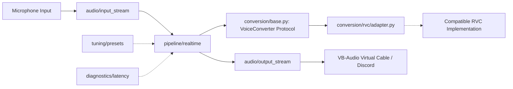

# System Architecture

## Overview

RealTimeVoiceChanger is structured around clean separation of concerns, decoupling audio capture/playback, pipeline orchestration, parameter tuning, and voice conversion inference engines.

## Module Responsibilities

### 1. `src/voice_changer/audio/`
Responsible for physical and virtual audio hardware communication:
- Device enumeration, querying, and selection (e.g., matching microphone inputs and virtual audio cable outputs).
- Low-latency audio input stream management (`input_stream.py`).
- Audio output stream management (`output_stream.py`).
- Device configuration (sample rates, buffer sizes, channel mapping).

### 2. `src/voice_changer/conversion/`
Defines the conversion boundary:
- `conversion/base.py`: Defines the `VoiceConverter` protocol/interface. This strictly decouples the audio streaming pipeline from any underlying inference engine or repository implementation.
- `conversion/rvc/`: Isolated adapter layer for an existing compatible RVC inference implementation (`conversion/rvc/adapter.py`). It translates raw chunked audio into the tensor formats expected by RVC and delegates inference, keeping third-party implementation specifics out of the core pipeline.

### 3. `src/voice_changer/pipeline/`
Handles end-to-end real-time execution:
- Coordinates audio chunk ingestion from `audio/input_stream`.
- Manages ring buffers, windowing, crossfading, and overlap-add to prevent audio clicks and seams.
- Dispatches audio chunks to the `VoiceConverter` implementation.
- Transmits converted audio chunks to `audio/output_stream`.
- Interacts with diagnostics to track processing times per chunk.

> **Design Rule:** The pipeline must **never** depend directly on RVC-specific internal classes or modules. It must only interact with `VoiceConverter`.

### 4. `src/voice_changer/tuning/`
Manages voice conversion parameters and presets:
- Pitch transposition (semitone offset for male-to-female shift).
- Pitch extraction settings (e.g. RMVPE algorithm configuration).
- Retrieval feature index blending rates.
- Consonant/breath protection parameters and formant adjustments.
- Preset serialization and loading (`presets.py`).

### 5. `src/voice_changer/diagnostics/`
Provides system and operational verification tools:
- `environment.py`: Inspects host OS, CPU, GPU/CUDA runtime, and audio driver backends.
- `latency.py`: Measures chunk processing latency, queue delays, and end-to-end turnaround time to monitor real-time constraints.

### 6. `scripts/`
Standalone development and diagnostic entry points:
- `check_environment.py`: Rapid verification of host platform, Python environment, and GPU availability.
- `list_audio_devices.py`: Scans available audio input and output endpoints and prints indices and driver information.

### 7. `models/`
Dedicated local repository for voice model checkpoints and indices:
- Stores `.pth` model weights and `.index` feature files locally.
- Strictly excluded from version control via `.gitignore`.
- Contains setup and placement instructions in `models/README.md`.

### 8. `tests/`
Organized into two distinct verification tiers:
- `tests/unit/`: Fast, isolated tests for configuration parsing, data structures, preset conversions, and interfaces.
- `tests/integration/`: End-to-end stream and pipeline verification, buffer flow validation, and adapter contract enforcement.

## GUI Boundaries

At this initial architectural phase, **no GUI directory or GUI dependencies are included**. All early milestones focus exclusively on audio pipeline stability, low latency, and voice quality. A GUI will be introduced only after the audio pipeline and conversion quality have been validated.
