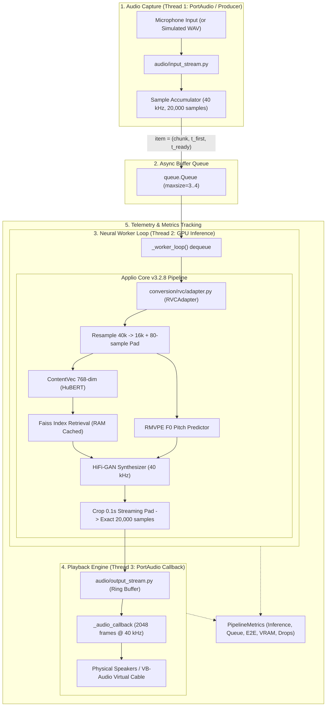

# System Architecture

## Overview

RealTimeVoiceChanger is structured around clean separation of concerns, decoupling audio capture/playback, pipeline orchestration, parameter tuning, and voice conversion inference engines.

## Module Responsibilities

### 1. `src/voice_changer/audio/`

Manages physical and virtual audio hardware communication and end-to-end streaming orchestration:

- **`devices.py`**: Enumerates and queries audio host APIs (WASAPI, MME, DirectSound) for inputs (microphones) and outputs (speakers, virtual cables).
- **`input_stream.py`**: Non-blocking microphone input capture using `sounddevice.InputStream` with low-latency block sizing (2048 frames).
- **`output_stream.py`**: Thread-safe ring buffer playback via `sounddevice.OutputStream` with prebuffering (`prebuffer_seconds = 0.15s`), underrun classification (startup silence vs steady-state glitch vs shutdown drain), and overflow protection.
- **`pipeline.py`**: Implements `RealTimeVoiceChangerPipeline` and `PipelineMetrics`. Coordinates multi-threaded producer accumulation, async bounded queue dispatch, GPU worker conversion, and latency tracking.

### 2. `src/voice_changer/conversion/`

Defines the decoupled voice conversion boundaries:

- **`base.py`**: Defines the `VoiceConverter` protocol and `ConversionConfig` dataclass. Decouples the audio streaming pipeline from any specific neural network backend.
- **`rvc/adapter.py`**: Encapsulates Applio Core v3.2.8.
  - Preloads and caches the Faiss retrieval index and `.npy` feature matrix directly into RAM to avoid disk read overhead (~165 ms/chunk saved).
  - Configures 0.1s low-latency streaming edge padding (`t_pad = 1600` at 16 kHz) instead of 1.0s/3.0s offline defaults.
  - Applies 80-sample symmetrical reflection padding at 16 kHz before feature extraction to prevent HuBERT receptive-field downsampling truncation, guaranteeing exact 70 feature frames and exact 20,000 output samples.

### 3. `src/voice_changer/tuning/`

Manages voice conversion parameters and presets:

- Pitch transposition (+10 to +12 semitones male-to-female offset).
- Pitch extraction algorithm settings (`f0_method="rmvpe"`).
- Feature retrieval index blending rate (`index_rate = 0.75`).
- Consonant/breath protection parameters (`protect_rate = 0.33`) and median filter radius (`filter_radius = 3`).
- Preset serialization and loading (`presets.py`).

### 4. `src/voice_changer/diagnostics/`

Provides system verification and performance telemetry:

- **`environment.py`**: Inspects host OS, CPU, GPU/CUDA compute capabilities, and audio driver APIs.
- **`latency.py`**: Analyzes processing duration, queue wait times, and end-to-end turnaround latency.

### 5. `scripts/`

Executable command-line tools for testing, benchmarking, and prototyping:

- **`check_environment.py`**: Rapid verification of Python, PyTorch, CUDA, and GPU availability.
- **`download_auxiliary_assets.py`**: Automated asset downloader for RMVPE (`rmvpe.pt`) and ContentVec checkpoints.
- **`list_audio_devices.py`**: Discovers available microphones and speaker/cable endpoints with device IDs.
- **`offline_conversion_test.py`**: Full offline WAV conversion validation script.
- **`profile_stages.py`**: Comprehensive stage-by-stage latency profiler (resampling, HuBERT, RMVPE, Faiss, HiFi-GAN).
- **`realtime_prototype.py`**: Full real-time prototype runner supporting both live microphone streaming and synchronized simulated WAV playback with JSON telemetry output.

### 6. `models/`

Local storage for model assets (strictly excluded from Git):

- `models/weights/`: Voice generator checkpoints (`.pth`).
- `models/indices/`: Faiss feature retrieval indices (`.index`).
- `models/checkpoints/`: Shared auxiliary models (`rmvpe.pt` and `contentvec/`).

---

## Latency Decomposition & Telemetry Architecture

The pipeline measures latency across clearly separated operational stages:

1. **Chunk Accumulation Window ($T_{\text{chunk}} = 500\text{ ms}$)**: Time required to accumulate 20,000 samples @ 40 kHz.
2. **Queue Wait Delay ($T_{\text{queue}} \approx 0.18\text{ ms}$)**: Immediate transfer from producer to the background worker thread.
3. **Inference Latency ($T_{\text{infer}} \approx 280\text{ ms}$)**: Neural processing on NVIDIA Quadro T2000 (ContentVec + RMVPE + Faiss + HiFi-GAN).
4. **Software E2E Turnaround ($T_{\text{software}} \approx 778\text{ ms}$)**: Monotonic elapsed time from first captured sample entering mic until converted chunk is written to playback buffer ($T_{\text{chunk}} + T_{\text{infer}}$).
5. **Output Buffer Occupancy ($B_{\text{ahead}} \approx 338\text{ ms}$)**: Audio ahead in playback buffer to absorb inference timing jitter.
6. **Estimated Acoustic Latency ($T_{\text{acoustic}} \approx 1117\text{ ms}$)**: Software E2E + Output buffer playback queue (excluding unmeasured physical hardware DAC/driver latency).
