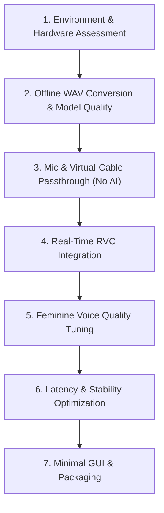

# Development Roadmap

This roadmap establishes the phased milestones for building RealTimeVoiceChanger. Each milestone must be verified before proceeding to the next.

---

## Milestone 1: Environment and Hardware Assessment

- **Objective:** Evaluate local Windows hardware, audio subsystems, and identify a compatible RVC inference runtime without breaking local environments.
- **Key Tasks:**
  - Audit Python version, Windows platform architecture, and available GPU/CUDA compute capabilities.
  - Test audio driver APIs available on Windows (WASAPI, MME, DirectSound).
  - Select and document compatible versions for PyTorch, CUDA, and the target RVC inference backend.
- **Exit Criteria:** Environment diagnostic report generated confirming compatible runtime targets.

---

## Milestone 2: Offline WAV Conversion and Model-Quality Evaluation

- **Objective:** Verify voice transformation quality on static audio files before introducing real-time streaming complexity.
- **Key Tasks:**
  - Acquire small, approved clean voice test samples (male speech).
  - Set up local RVC model files (`.pth` weights and `.index` file).
  - Implement and test offline conversion using `conversion/rvc/adapter.py`.
  - Evaluate output naturalness, pitch accuracy, and presence of artifacts.
- **Exit Criteria:** Offline conversion produces a clear, natural-sounding feminine voice without glitching.

---

## Milestone 3: Microphone and Virtual-Cable Passthrough (Without AI)

- **Objective:** Validate the audio I/O streaming foundation and routing to VB-Audio Virtual Cable with zero AI inference.
- **Key Tasks:**
  - Implement `audio/devices.py` to enumerate microphones and virtual cable inputs.
  - Implement `audio/input_stream.py` and `audio/output_stream.py`.
  - Build `pipeline/realtime.py` in passthrough mode (direct input-to-output chunk routing).
  - Route audio into VB-Audio Virtual Cable and verify reception in Discord/recording tools.
- **Exit Criteria:** Clean, crackle-free audio passthrough with baseline hardware latency < 20ms.

---

## Milestone 4: Real-Time RVC Integration

- **Objective:** Connect the chunked real-time audio pipeline to the RVC conversion adapter.
- **Key Tasks:**
  - Implement real-time ring buffering, chunk windowing, and overlap-add crossfading.
  - Integrate `conversion/rvc/adapter.py` into the active streaming loop.
  - Verify continuous audio flow without buffer underruns under steady-state conditions.
- **Exit Criteria:** Continuous real-time voice conversion operating from microphone input to virtual cable output.

---

## Milestone 5: Feminine Voice Quality Tuning

- **Objective:** Optimize male-to-female voice transformation parameters for maximum naturalness.
- **Key Tasks:**
  - Calibrate pitch shift (+12 semitones baseline, fine-tuned per vocal range).
  - Benchmark pitch extraction algorithms (RMVPE vs Harvest vs PM) for latency vs accuracy.
  - Adjust feature retrieval index rate (`index_rate`) to balance timbre matching vs acoustic artifacts.
  - Configure consonant protection (`protect_rate`) and breath preservation.
  - Save optimized configuration profiles into `tuning/presets.py`.
- **Exit Criteria:** Voice conversion achieves high speech intelligibility and natural feminine timbre without robotic distortions.

---

## Milestone 6: Latency and Stability Optimization

- **Objective:** Minimize end-to-end turnaround latency while maintaining robust streaming stability.
- **Key Tasks:**
  - Profile end-to-end latency: input capture + buffer slicing + inference + overlap blending + output buffer.
  - Benchmark chunk size tradeoffs (e.g. 128ms vs 256ms vs 512ms).
  - Optimize memory copies and GPU tensor allocation in the adapter.
  - Conduct extended duration stress tests (30+ minutes) to ensure no memory leaks or stream degradation.
- **Exit Criteria:** Stable end-to-end latency suitable for conversation (< 250-300ms target on capable GPU) with 0 dropped frames over 30 minutes.

---

## Milestone 7: Minimal GUI and Packaging

- **Objective:** Provide a lightweight, user-friendly interface for device selection and preset tuning.
- **Key Tasks:**
  - Build a clean desktop interface for selecting audio devices, loading models, and adjusting pitch/volume.
  - Add visual audio meters for input signal, output signal, and active latency readout.
  - Package the application for simple local execution.
- **Exit Criteria:** A self-contained, responsive desktop application ready for daily use.
