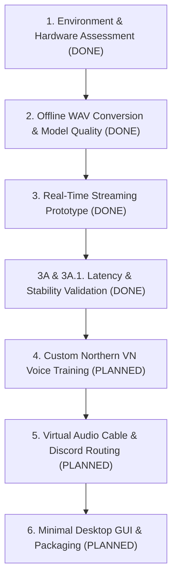

# Development Roadmap

This roadmap establishes the phased milestones for building RealTimeVoiceChanger. Each milestone must be verified before proceeding to the next.

---

## Milestone 1: Environment and Hardware Assessment [COMPLETED]

- **Objective:** Evaluate local Windows hardware, audio subsystems, and identify a compatible RVC inference runtime without breaking local environments.
- **Completed Deliverables:**
  - Audited Python version (3.11.9), Windows 11 platform architecture, and NVIDIA Quadro T2000 Mobile GPU (Turing, compute capability 7.5, 4 GB VRAM).
  - Pinned and isolated Applio Core v3.2.8 (`third_party/applio`) with PyTorch 2.5.1 + CUDA 12.1 runtime.
  - Implemented `scripts/check_environment.py` and `scripts/download_auxiliary_assets.py` to automate verification and asset fetching (`rmvpe.pt` and `contentvec`).
- **Exit Status:** **PASS**. Clean reproducible environment verified.

---

## Milestone 2: Offline WAV Conversion and Model Evaluation [COMPLETED]

- **Objective:** Verify voice transformation quality on static audio files before introducing real-time streaming complexity.
- **Completed Deliverables:**
  - Set up target voice model `vctk_female_p231` (`models/weights/vctk_female_p231.pth` and `models/indices/vctk_female_p231.index`).
  - Implemented `RVCAdapter` (`src/voice_changer/conversion/rvc/adapter.py`) wrapping Applio Core v3.2.8.
  - Created automated offline test suite `scripts/offline_conversion_test.py`.
  - Achieved offline conversion Real-Time Factor (RTF) of **0.345** (11.1s processing for 32.2s audio), zero clipping, zero silence.
- **Exit Status:** **PASS**. Model loading, pitch extraction, feature retrieval, and audio synthesis validated.

---

## Milestone 3: Real-Time Audio Pipeline Prototype [COMPLETED]

- **Objective:** Validate the audio I/O streaming foundation and asynchronous neural inference pipeline.
- **Completed Deliverables:**
  - Implemented `AudioInputStream` and `AudioOutputStream` in `src/voice_changer/audio/` using SoundDevice/PortAudio.
  - Built `RealTimeVoiceChangerPipeline` (`src/voice_changer/audio/pipeline.py`) with bounded asynchronous worker thread queue (`queue.Queue(maxsize=3)`).
  - Created `scripts/realtime_prototype.py` supporting both physical microphone input and synchronized simulated WAV streaming.
  - Initial baseline with 1.0s chunks converted in real-time (RTF ~0.88, turnaround ~890ms).
- **Exit Status:** **PASS**. Continuous non-blocking audio streaming operational.

---

## Milestone 3A & 3A.1: Latency Reduction & 5-Minute Stability Validation [COMPLETED]

- **Objective:** Minimize turnaround latency and prove multi-minute streaming stability without buffer underruns.
- **Completed Deliverables:**
  - **Latency Optimizations:**
    - Cached Faiss feature index in RAM to eliminate per-chunk disk reload overhead (~165 ms saved).
    - Reduced streaming edge padding from 1.0s/3.0s down to 0.1s (1600 samples @ 16 kHz).
    - Transitioned baseline chunk size from 1.0s to 0.50s (20,000 samples @ 40 kHz).
    - Reduced Mean Inference Latency from ~890 ms to **~280.8 ms** (RTF = **0.562**).
  - **Algorithm & Sample Count Alignment:**
    - Resolved ContentVec frame truncation by applying 80-sample reflection padding per side at 16 kHz, producing exact 70 feature frames and exact 20,000 output samples (100.0% sample integrity, zero loss).
  - **Long-Run 5-Minute Validation:**
    - Processed **600/600 chunks** over 301.0 seconds continuously.
    - Achieved **0 steady-state underruns**, **0 queue backlog drops**, **0 input overflows**, and **0 sample count mismatches**.
    - Maintained stable GPU VRAM at **~444.5 MB** with zero memory leaks.
- **Exit Status:** **PASS**. Pipeline stability and telemetry thoroughly proven.

---

## Milestone 4: Custom Voice Dataset & Model Training [PLANNED]

- **Objective:** Create a warm, soft, natural Northern Vietnamese female conversational voice model to replace the English VCTK p231 technical placeholder.
- **Key Tasks:**
  - Curate high-quality, dry conversational recordings (consented speaker dataset, 24-bit 48kHz WAV, 1–3 hours).
  - Clean and segment audio (denoising, loudness normalization, silence trimming).
  - Train custom RVC v2 model with RMVPE pitch guidance and extract Faiss retrieval index.
  - Validate model inference within the existing pipeline adapter without architectural modifications.
- **Exit Criteria:** High speech intelligibility and warm, organic Northern Vietnamese feminine timbre.

---

## Milestone 5: Virtual Audio Cable Integration & Quality Tuning [PLANNED]

- **Objective:** Route converted audio seamlessly to Discord, OBS, and games, and optimize vocal acoustics.
- **Key Tasks:**
  - Connect `AudioOutputStream` directly to VB-Audio Virtual Cable / Hi-Fi Cable.
  - Implement dynamic noise gate, formant shift corrections, and consonant protection tuning (`protect_rate`).
  - Create pre-configured acoustic presets in `src/voice_changer/tuning/presets.py`.
- **Exit Criteria:** Seamless voice chat in Discord with minimal acoustic leakage and high intelligibility.

---

## Milestone 6: Minimal Desktop GUI & Packaging [PLANNED]

- **Objective:** Provide a lightweight, user-friendly control interface for daily operation.
- **Key Tasks:**
  - Build a clean GUI for selecting audio devices, setting pitch shift, choosing models, and monitoring latency meters.
  - Package standalone executable or launch script with automatic GPU preflight checking.
- **Exit Criteria:** Self-contained, responsive desktop application ready for non-technical usage.
